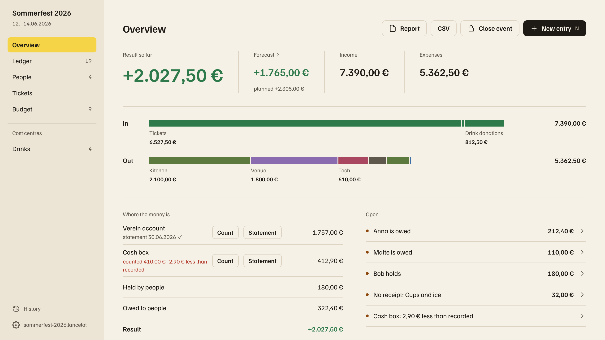
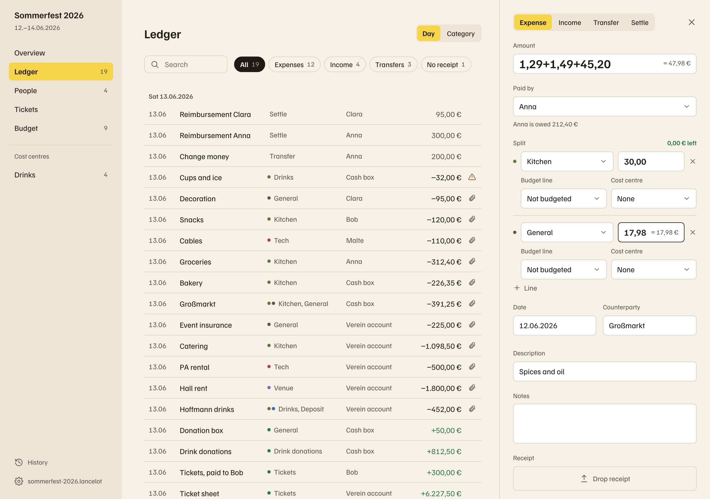
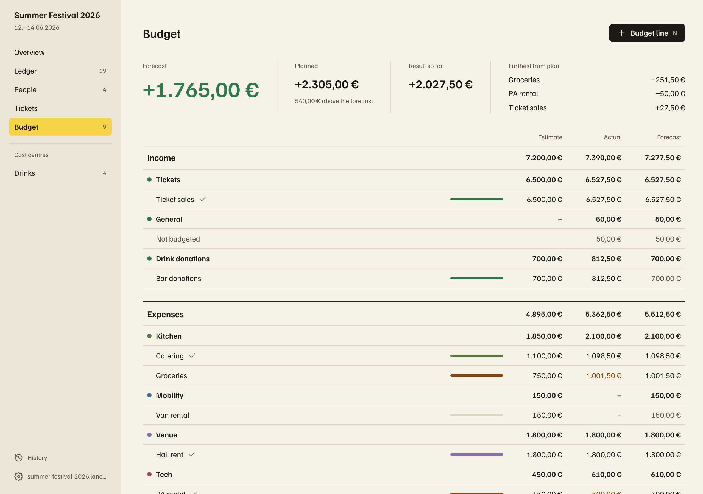
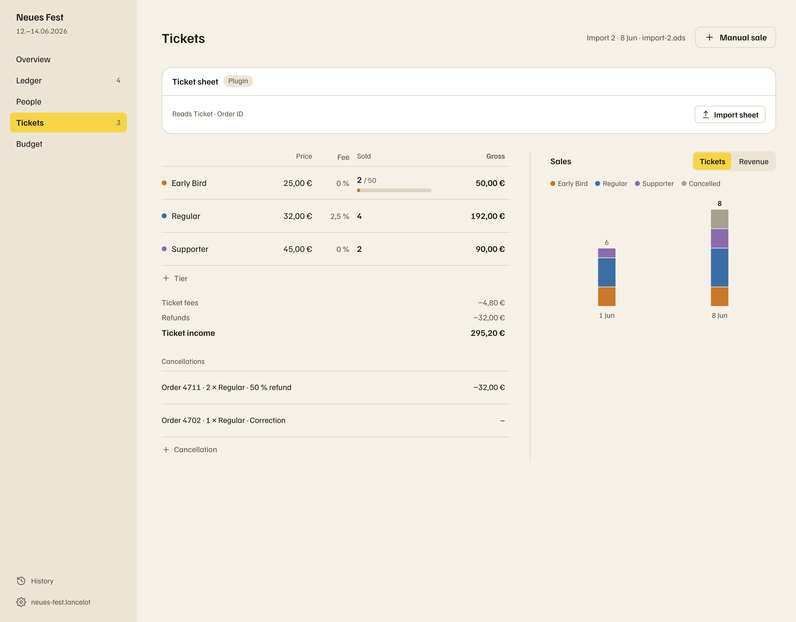
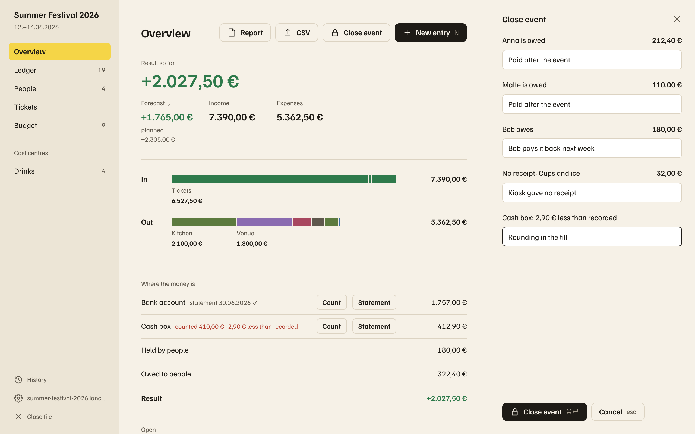

# Lancelot

A local desktop app for settling volunteer-run events: receipts, advances, reimbursements, tickets and drinks, in one file per event.

<picture>
  <source media="(prefers-color-scheme: dark)" srcset="docs/manual/images/readme-overview-dark.png">
  
</picture>

Lancelot replaces the spreadsheet a group passes around after a festival, a party or a camp. Volunteers pay from their own pockets, the cash box changes hands, tickets come in from a shop and drinks are sold on commission. At the end someone has to work out who is owed what, whether the money adds up, and what the event made. Lancelot keeps all of that in one place and tells you what is still open before you close the books.

## What it does

<table>
  <tr>
    <td width="50%"></td>
    <td width="50%"></td>
  </tr>
  <tr>
    <td><b>Enter money quickly.</b> Expenses, income, transfers and settlements, split over categories, with the receipt dropped onto the window. Amount fields add up sums like <code>1,29+1,49</code>.</td>
    <td><b>Plan against actual.</b> Budget lines per category and cost centre, a cautious forecast of the result, and the lines furthest from the plan.</td>
  </tr>
  <tr>
    <td></td>
    <td></td>
  </tr>
  <tr>
    <td><b>Tickets and drinks.</b> Import ticket sheets with a review of every change, resolve cancellations and refunds, and track drinks per product against the supplier's invoice.</td>
    <td><b>Close with nothing left open.</b> Balances, missing receipts and count mismatches block closing until they are fixed or accepted with a note. Then print the settlement report.</td>
  </tr>
</table>

Also: a balance and reimbursement method per person, a payout list as CSV or PDF, opening and closing counts per account, statement checks, a full change history, and templates from past events. The [feature list](docs/features.md) has everything.

## How it works

- **One file per event.** A `.lancelot` file is a SQLite database holding every entry and every receipt. Copy it, back it up, hand it to the next treasurer.
- **Local only.** No account and no server. The network is used only when you pull tickets or drink counts from a data source you set up yourself.
- **Exact money.** All arithmetic happens in the Rust core in integer cents, and every open and save checks the file's integrity. The interface only formats the figures.
- **Plugins for the optional parts.** Drinks, ticket sheets and ticket APIs are built-in plugins you switch on per event ([writing one](docs/plugins.md)).

Built with Tauri 2, Svelte 5 and Rust, for macOS, Windows and Linux.

## Status

Lancelot is in active development. Everything in the [feature list](docs/features.md) works, but no real event has been settled in it yet. The next step on the [roadmap](docs/roadmap.md) is running one alongside the old spreadsheet and reaching the same final balance.

## Documentation

|                                                         |                                                     |
| ------------------------------------------------------- | --------------------------------------------------- |
| [User manual](docs/manual/index.html)                   | How to settle an event, screen by screen            |
| [Features](docs/features.md)                            | What the app can do today                           |
| [Requirements](docs/requirements.md)                    | What it should do, with IDs the other docs refer to |
| [Roadmap](docs/roadmap.md) and [Future](docs/future.md) | What comes next, and ideas for later                |
| [Technical design](docs/technical-design.md)            | Decisions and invariants the code doesn't explain   |
| [Writing a plugin](docs/plugins.md)                     | How a built-in plugin is put together               |
| [Design notes](docs/design/README.md)                   | Visual language, tokens and motion                  |

## Development

Requirements: Rust (stable, ≥ 1.90), Node 24, pnpm 12 (the exact version is pinned in `app/package.json`), and Xcode command line tools on macOS. Without a global pnpm, prefix the commands with `npx pnpm@12.15.0` instead of `pnpm`.

The frontend and the Tauri shell live in `app`, so the pnpm commands run there. From the repository root:

```bash
cd app
pnpm install      # once, and again when dependencies change
pnpm tauri dev    # the desktop app, reloading as you edit
```

To look at the screens in a plain browser instead, against the real core and throwaway event files, start the bridge and the UI in two terminals and open <http://localhost:5173> ([details](docs/technical-design.md#5-ipc-contract)):

```bash
cargo run -p lancelot-bridge    # terminal 1, from the repository root
```

```bash
cd app && pnpm dev              # terminal 2
```

Run all checks from the repository root, the same ones CI runs on every push:

```bash
scripts/check.sh
```

Full app builds for macOS, Windows and Linux run weekly and on demand (`.github/workflows/build.yml`).

The [user manual](docs/manual/index.html) is a static page. Its screenshots, and the ones in this README, come from the same script. To retake them with the bridge and UI running, run `pnpm manual:screenshots` in `app` (details at the top of `app/scripts/manual-screenshots.mjs`).

`app/src/lib/styles/tokens.css` is copied from `docs/design/tokens.css` with `pnpm tokens`. Do not edit the copy.
